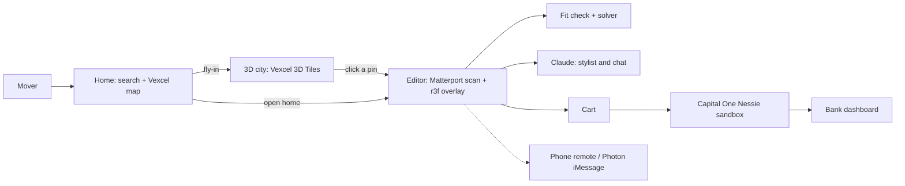

# FurNiche AI


**Live demo:** [furniche-ai.vercel.app](https://furniche-ai.vercel.app)

Furnish a real Houston listing before you move in. Open the home's Matterport scan in its
empty-room view, shop furniture from IKEA, Amazon, West Elm, Wayfair and Target, and drop each
piece into the room at its true size. FurNiche AI checks the fit, styles a room for you, prices
paint and flooring, plans the yard on a Vexcel aerial image, and checks out through a Capital One
sandbox account.

Built at HackPrinceton Fall 2026 for CoStar's "Inside and Out: AI for the Built World" track.

## The question

> **Will my stuff actually fit, and can I afford to move in?**

Listing photos show an empty room. A product page shows a number in inches. Nothing connects the
two, and nothing checks the result against rent. FurNiche AI puts the real product, at its real
size, inside the real scan, then checks the fit and the budget before you buy.

## Introducing FurNiche AI

FurNiche AI is a try-before-you-move workspace for renters and buyers. You start from a CoStar
listing, fly in from a 3D city view to the home's Matterport scan, and furnish it with real
catalogue products. A deterministic solver lays rooms out and checks every piece against the
room's walls and doors. Claude only chooses the products and the look; it never places anything.

What it lets a mover do:

- Find a home in plain words and see it on a Vexcel aerial map or in a 3D city
- Walk into the scan and drop real furniture at catalogue size
- Auto-furnish every room in one click, with art, mirrors, plants and a dressed bed
- Get a fit check, paint and flooring quantities, and a yard plan
- Pay for the cart from a Capital One sandbox account and see the result in a banking dashboard

## Built with

- Next.js 14 (App Router), React 18, TypeScript, Tailwind CSS, zustand
- `@matterport/webcomponent` and `@matterport/r3f` host the scan; furniture is rendered with
  three.js (react-three-fiber) inside Matterport's scene
- `3d-tiles-renderer` for the Vexcel 3D city; Leaflet for the search map

**Data and APIs**

- Matterport Model API (GraphQL): rooms, walls, panoramas
- Vexcel property API, ortho tiles and 3D Tiles for Houston
- CoStar hackathon kit: listings and Matterport links
- Capital One Nessie v2 (sandbox): accounts, bills, purchases, transactions
- Anthropic Claude: stylist, chat, product import, size estimates (all have rule-based fallbacks)
- Photon: the same assistant over iMessage (optional)
- Hugging Face ZeroGPU Spaces (or your own GPU): Photo to 3D

**Infrastructure**

- Vercel (CLI deploys, because the build needs git-ignored `data/`)
- A service worker caches the large Matterport model files in the browser

## Architecture overview



| Layer | What it does | Where |
| --- | --- | --- |
| Scan | Hosts the Matterport tour in its defurnished view | `components/viewer/MatterportHost.tsx` |
| Overlay | Draws furniture, wall art, mirrors and paint with a depth occluder, so pieces sit behind real walls | `components/viewer/` |
| Sensing | Raycasts the scan for doorways, windows, counters and plain wall | `lib/scanSense.ts` |
| Solver | Places pieces against walls, keeps walkways clear, drops optional pieces that break the fit | `lib/solver.ts`, `lib/autofurnish.ts` |
| Fit | Separating-axis tests on footprints, walkway and door rules | `lib/fit.ts` |
| Stylist | Claude picks products, never positions | `app/api/stylist`, `lib/llm.ts` |
| Money | Nessie accounts, bills, purchases, bank summary and health score | `lib/nessie.ts`, `lib/bankSummary.ts` |

## Key features

### Search and fly-in

- **Search in plain words.** "3 bed apartments under $2,000" or "studio in Montrose under
  $1,500". Matches appear as price tags on a Vexcel aerial map with a carousel; neighbourhood names
  become a radius search.
- **Float over the 3D city.** Vexcel's 3D mesh of Houston streams into the browser with every
  match above its building. Hover a card to glide to that home, click a pin to walk inside.
  Vexcel's 3D collection covers Houston only, so far-north homes open the scan directly.
- **Explore.** The header link returns to the home list. A featured listing is pinned 6th.

### Furnish the real room

- **Drag and drop.** Drag a product from the shop onto the floor; it lands at its catalogue size.
  Drag to move, `R` rotate, `D` duplicate, `Delete` remove.
- **Auto-furnish.** One click styles every room by type and size: living rooms, bedrooms, dining
  rooms and open-plan living and dining get complete sets (sofa and coffee table, bed with
  nightstands and wardrobe, table with chairs and a flower pot, rug, TV console, plants).
- **Occupied-room details.** Pictures hang on interior side walls, not over windows or doors;
  mirrors stand upright, reflect the room and keep floor clear in front; beds come with a
  mattress, duvet and pillows; new pieces settle in with a short animation.
- **IKEA catalogue.** About 255 products across beds, sofas, tables, storage, rugs, lighting,
  mirrors, wall art and decor, with measurements read from product pages and photo textures served
  through a same-origin proxy.
- **Fit check.** Crossing a wall, overlapping, taller than the ceiling, blocking a marked door,
  and walkways under 76 cm. Seat-and-table pairs get their own spacing rule.
- **Floor plan.** A to-scale plan from the scan's wall graph, with the same drag and fit check.
  Use **Mark doors** to tell the solver about closets and doors the scan cannot show.

### Style and plan

- **AI stylist.** Describe a look and budget ("warm japandi under $3,000"). Claude picks
  products; the solver places them.
- **Paste a link.** Paste a product page; FurNiche AI reads its structured data for name, price
  and size (including fractional inches). It never guesses a size.
- **Photo to 3D.** Upload a photo of any piece and it becomes a textured 3D model, free. Quick
  takes seconds, Max detail about a minute. Type one real measurement and the rest follow the
  model's shape.
- **Walls and floor.** Paint, wallpaper and flooring per room, with gallons (2 coats, 350 sq ft
  per gallon, 15% for openings) and flooring area (+10% waste). Paint runs up to the ceiling line.
- **Mood boards.** Six themes with palettes, finishes and matching products.
- **Plan the yard.** The Vexcel aerial image is shown to scale with the parcel line and building
  footprints; pieces off the lot or on a building turn red.

### Assistants

- **Ask FurNiche AI (chat).** Knows the open home and design. Add, remove or swap furniture,
  "make this room feel bigger", change paint, flooring and light. Runs on Claude with tools; common
  commands still work by keyword without a key.
- **Phone remote.** Scan the QR code and your phone controls the tour on the big screen: look
  around, step, switch rooms, Auto-furnish, chat. The phone must be on the same Wi-Fi, and the
  relay lives in the app server's memory, so run one server.
- **Text it on iMessage (Photon).** With Photon keys set, the same assistant answers iMessages and
  edits sent by text update the 3D room live.

### Cart, payment and banking

- **Cart.** One shopping list grouped by store with buy links, in a two-column layout with a
  payment panel.
- **Swipe to pay with Capital One.** Pick an account, check it against the move-in budget, then
  swipe to post one Nessie purchase per store. No card number is typed, shown or stored.
- **Move-in budget.** Reads checking, savings and card, bills and paychecks from the Nessie
  sandbox and shows what is safe to spend (bills and a $500 cushion kept back, 40% of savings,
  card under 30% use). Without `NESSIE_API_KEY` the same numbers come from demo data.
- **Banking dashboard.** Click the Capital One card to open `/bank` in a new tab: balances,
  transactions, a spent-versus-saved ring, weekly spending, category breakdown, top merchants,
  every card, and a financial health score with tips. Orders you pay for show up as transactions.
  Everyday activity beyond what the sandbox holds is generated and marked as sample.

## Core user flow

1. **Find.** Search in words; results land on the aerial map and the home list.
2. **Fly in.** Choose a home; the 3D city glides to the building and drops you into the scan.
3. **Furnish.** Drag pieces in, ask the stylist, or press Auto-furnish for the whole home.
4. **Check.** The fit check flags walls, overlaps, doors and tight walkways; paint and flooring
   quantities update.
5. **Budget.** The budget strip shows what you can safely spend before rent.
6. **Pay.** Swipe to pay a Capital One sandbox account; open the dashboard to see it posted.
7. **Share.** The share link carries the whole design in the URL.

## Run it

Needs Node.js 20.9 or newer.

```bash
npm install --legacy-peer-deps
cp .env.example .env.local          # fill in the keys
npx matterport-assets public/matterport-assets   # Matterport viewer files (not in git)
python3 scripts/build_listings.py   # builds data/listings.json (Houston; --region la for LA)
python3 scripts/build_ikea_catalog.py   # refreshes catalog/ikea-catalog.json from IKEA's search (optional)
# No matterport_kit/models_index.csv? Build one from the Model API, then point the script at it:
#   node scripts/build_model_index.mjs --kit <kit>
#   python3 scripts/build_listings.py --kit <kit> --index data/models_index.csv
npm run dev                          # http://localhost:3000
npm test
```

Open the app at `http://localhost:3000` (not `127.0.0.1`): the Matterport SDK key is limited to
localhost. The CoStar kit and the generated `data/listings.json` are not in this repo; they come
from the hackathon organisers.

### Environment variables

Copy `.env.example` to `.env.local`. The Matterport and Vexcel keys are required; the rest are
optional and each has a fallback.

| Variable | Needed for |
| --- | --- |
| `MATTERPORT_API_KEY`, `MATTERPORT_API_TOKEN`, `NEXT_PUBLIC_MATTERPORT_SDK_KEY` | Scans, rooms and walls |
| `VEXCEL_API_KEY` | Aerial map, parcels, 3D city (kept server-side) |
| `ANTHROPIC_API_KEY` | Stylist, chat, product import (rule-based fallback) |
| `NESSIE_API_KEY` | Capital One sandbox budget, checkout, dashboard (demo data without it) |
| `PHOTON_PROJECT_ID`, `PHOTON_API_KEY` | iMessage assistant |
| `HF_TOKEN` | More free GPU time for Photo to 3D |
| `PHOTO3D_GPU_URL`, `PHOTO3D_GPU_TOKEN` | Your own GPU for Photo to 3D, no daily limit |

### Deploy

```bash
npm run lint && npm test            # lint errors fail the remote build
npx vercel deploy --prod --yes
```

Git-triggered deploys are turned off in `vercel.json`, because the build needs the git-ignored
`data/` folder. Deploy from a machine that has it.

## Project layout

| Path | What it holds |
| --- | --- |
| `app/` | Pages (`/`, `/space/[sid]`, `/sky`, `/cart`, `/bank`, `/boards`) and API routes |
| `app/api/` | `stylist`, `chat`, `budget`, `bank`, `photo3d`, `photon`, `product-image`, `vexcel`, `remote` |
| `components/viewer/` | Matterport host, furniture layer, surface (paint) layer, 3D furniture shapes |
| `components/bank/`, `components/shop/` | Capital One card, charts, checkout, swipe to pay |
| `lib/solver.ts`, `lib/autofurnish.ts` | Room layout solver and Auto-furnish |
| `lib/scanSense.ts`, `lib/closets.ts`, `lib/hang.ts` | Scan sensing, closet and doorway inference, wall-art placement |
| `lib/fit.ts` | Fit and walkway checks (pure, unit tested) |
| `lib/bankSummary.ts`, `lib/nessie.ts` | Banking summary, categories, health score |
| `catalog/` | Curated product catalogue and the IKEA catalogue |
| `scripts/` | Listing, catalogue and Matterport model-index builders; Photo to 3D GPU helpers |
| `docs/PLAN.md` | Original build plan |

## How it works

- `lib/matterport.ts` reads rooms, walls and panos from the Matterport Model API (GraphQL).
- `lib/vexcel.ts` reads the parcel and buildings from Vexcel's property API and frames the ortho
  image on the same centre so the overlay lines up. Ortho tiles and the 3D Tiles mesh go through
  server routes so the API key never reaches the browser.
- `/sky` renders the 3D city with `3d-tiles-renderer`. The Draco and KTX2 decoders in
  `public/decoders/` are copied from three.js.
- `lib/search.ts` turns plain-language queries into filters (rules, plus Claude when a key is set).
- `lib/fit.ts` and `lib/solver.ts` are pure functions with unit tests. `lib/scanSense.ts` raycasts
  the scan for doorways, windows and flat counters, and Auto-furnish uses them to keep pieces off
  doors and windows.
- Photo to 3D (`lib/photo3d.ts`, `/api/photo3d`) runs free on Hugging Face's shared GPUs, called
  with `@gradio/client`. Quick uses Stability AI's Stable Fast 3D, Max detail uses Microsoft's
  TRELLIS. Hugging Face meters free use per day, so build demo pieces ahead of time in the browser
  you will demo from; models are kept in the browser (IndexedDB) and cached on the server by the
  photo's hash. iPhone (HEIC) photos are converted on the server in WebAssembly. To run with no
  daily limit, use `scripts/photo3d_local.py` on this computer or `scripts/photo3d_gpu.ipynb` on a
  free Kaggle or Colab GPU, and set `PHOTO3D_GPU_URL`.
- Designs are saved in the browser; there are no accounts and nothing is sold.

## Data and credits

CoStar hackathon kit (listings, Matterport links), Matterport, Vexcel, Capital One Nessie,
Anthropic, Photon, Hugging Face Spaces (Stable Fast 3D, TRELLIS), and IKEA product pages for
catalogue measurements.
