# FurNiche AI

**Live demo:** [https://furniche.biz](https://furniche.biz)

FurNiche AI lets you furnish a real housing listing before you settle in. It finds you a listing via Vexcel aerial map, where in you fly in over Vexcel's 3D city and open the home's Matterport scan in an empty-room view. Shop artistic furniture and appliances from IKEA, drop each piece into the room at its true size and let the app check the fit and style in one click, price paint and flooring, plan the yard on a Vexcel aerial image and pay through a Capital One sandbox account. Built at HackPrinceton Fall 2026.

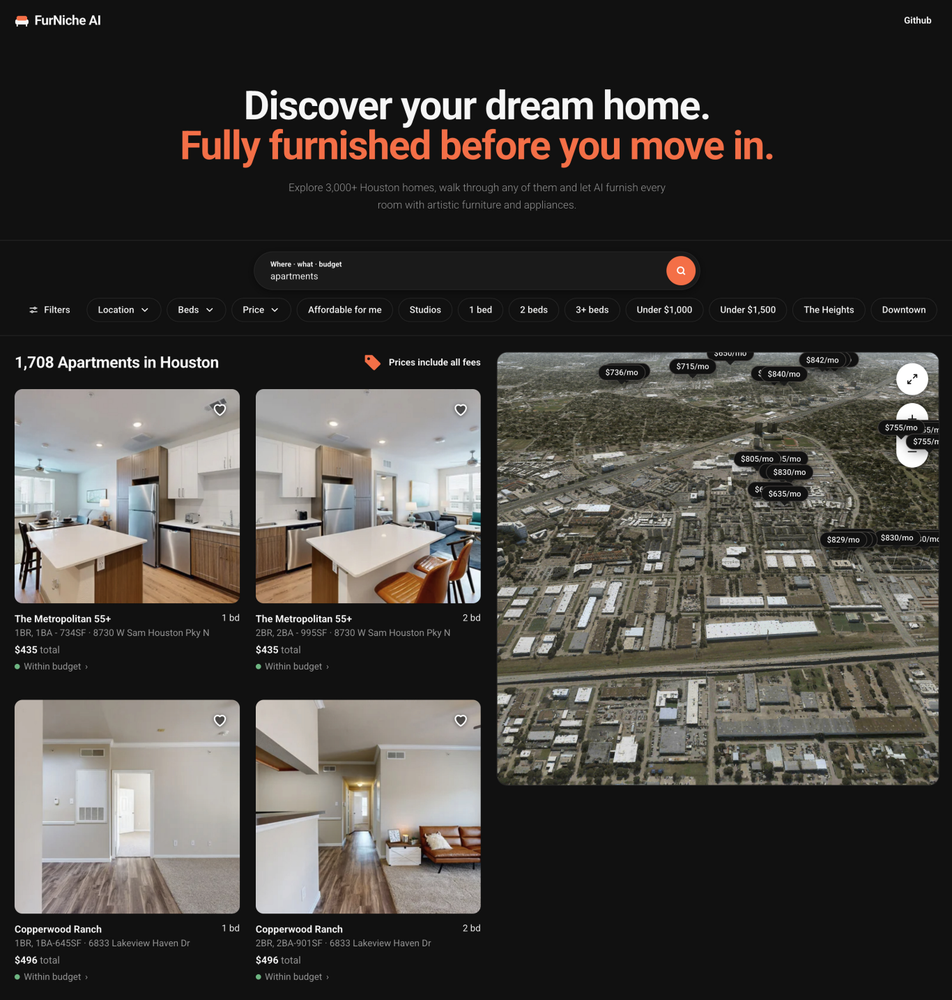

## Introducing FurNiche AI

Listing photos show an empty room, and a product page shows a number in inches. Nothing connects the two, and nothing checks the result against rent. FurNiche AI puts the real product, at its real size, inside the real scan, then checks the fit and the budget before you buy.

You start from a CoStar listing, fly in from a 3D city view into the home's Matterport scan, and furnish it with real catalogue products. A deterministic solver lays rooms out and checks every piece against the room's walls and doors. Claude only chooses the products and the look; it never places anything.

FurNiche AI lets a mover:

- Search for a home in plain words and see it on a Vexcel aerial map or in a 3D city
- Walk into the scan and drop real furniture at catalogue size
- Auto-furnish every room in one click, with art, mirrors, plants and a dressed bed
- See the room at any time of day, with the sun placed for the home's location
- Get a fit check, paint and flooring quantities, and a yard plan
- Check whether they can afford the home, rent versus buy, and what moving in costs
- Pay the cart from a Capital One sandbox account and read it back in a banking dashboard

## Key Features

### Search and Fly-in

- Search in plain words: "3 bed apartments under $2,000" or "studio in Montrose under $1,500". Matches appear as price tags on a Vexcel aerial map with a carousel of every result. Neighbourhood names become a radius search.
- Vexcel's 3D mesh of Houston streams into the browser with every match above its building. Hover a card to glide to that home, click a pin to walk inside. Homes outside the mesh open the scan directly.

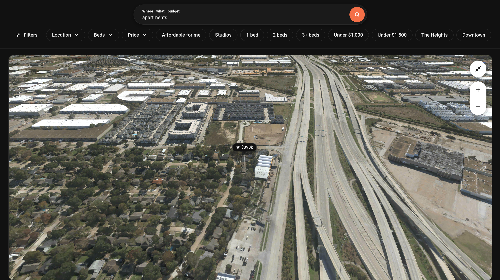

### Furnish the Real Room

- Drag a product from the shop onto the floor and it lands at its catalogue size. Drag to move, `R` rotate, `D` duplicate, `Delete` remove.
- **Auto-furnish** styles every room by type and size, from sofa and coffee table to bed, nightstands and wardrobe, a dining table with chairs and a flower pot, rugs, TV console and plants. Pictures hang on interior walls, mirrors stand upright, and new pieces settle in with a short animation.
- The fit check flags a piece that crosses a wall, overlaps another, is taller than the ceiling, blocks a marked door, or leaves a walkway under 76 cm.

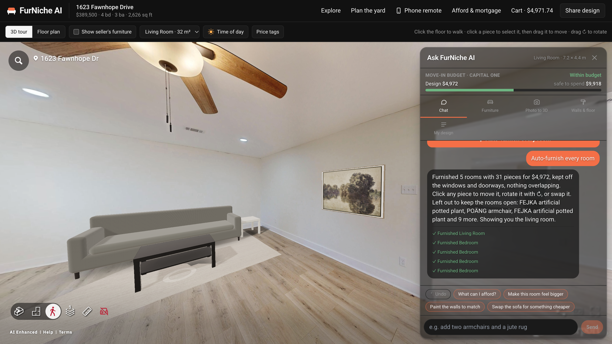

### Time of Day

Pick any hour and the scene is lit for the home's location: the sun's position comes from standard solar formulas, with sunbeams through the windows and a night mode when the windows go dark.

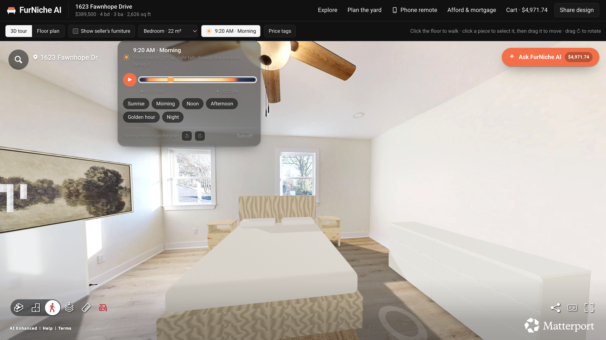
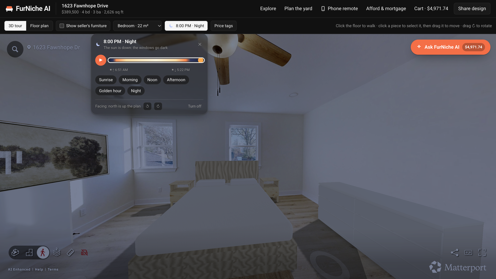

### AI Stylist, Swaps and Chat

- Describe a look and a budget ("warm japandi under $3,000"). Claude picks products; the solver places them and drops optional pieces that would break the fit.
- Click any piece to see swaps: best match, cheaper, premium, and others that also fit. IKEA prices are checked live.
- The chat knows the open home and design: add, remove or swap furniture, "make this room feel bigger", change paint, flooring and light. Without an Anthropic key, common commands still work by keyword.

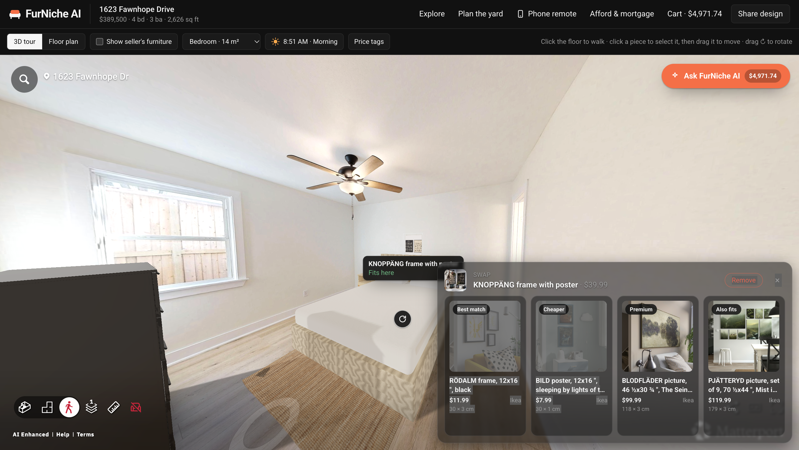

### Plan, Paint and More

- **Photo to 3D:** upload a photo of any piece and it becomes a textured 3D model, sized from what the browser recognises it to be. Every model is kept in My Scans.
- **Walls and floor:** paint, wallpaper and flooring per room, with gallons (2 coats, 350 sq ft per gallon, 15% for openings) and flooring area (+10% waste).
- **Plan the yard:** the Vexcel aerial image shown to scale with the parcel line and building footprints.
- **Floor plan, mood boards, paste-a-link import:** a to-scale plan from the scan's wall graph, six themes, and product import from any page's structured data. A size is never guessed.
- **Phone remote and iMessage:** scan a QR code to steer the tour from your phone, or text the assistant through Photon.

### Cart and Swipe to Pay

One shopping list grouped by store with buy links, in a two-column layout. Pick a Capital One sandbox account, check it against the move-in budget, then swipe to post one Nessie purchase per store. No card number is typed, shown or stored.

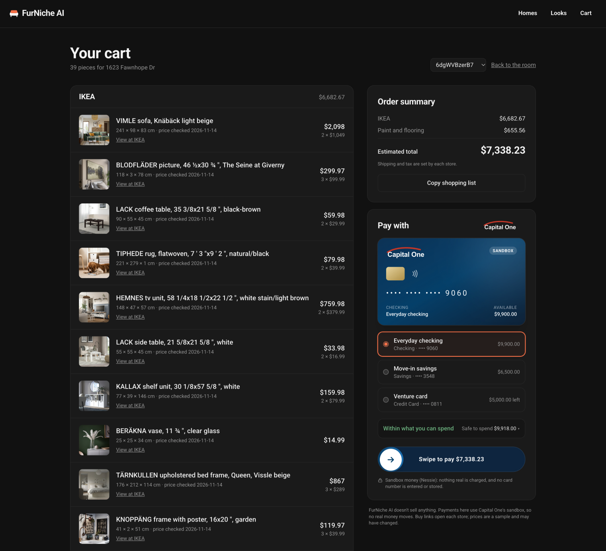

### Banking Dashboard

Click the Capital One card to open `/bank` in a new tab: balances, a spent-versus-saved ring, weekly spending, a category breakdown, top merchants, every card, transactions, and a financial health score with tips. Orders you pay for appear as transactions. Everyday activity beyond what the sandbox holds is generated and marked as sample.

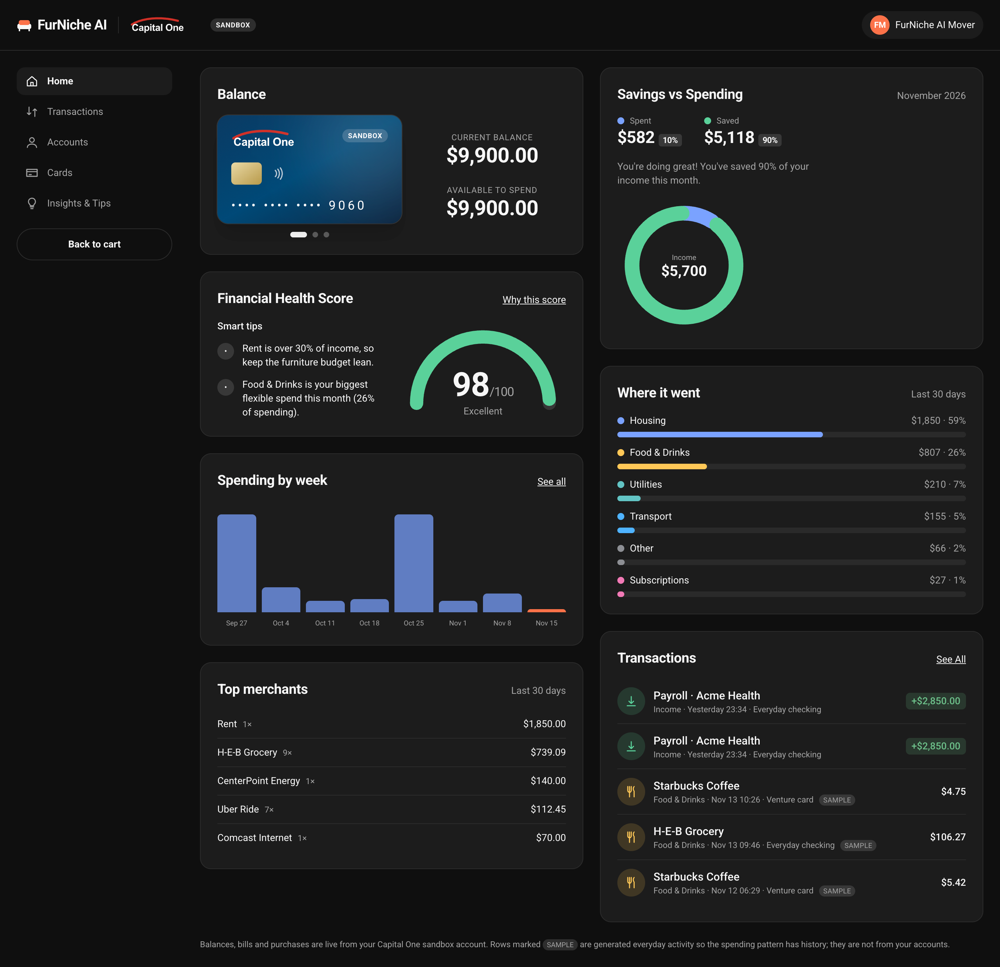
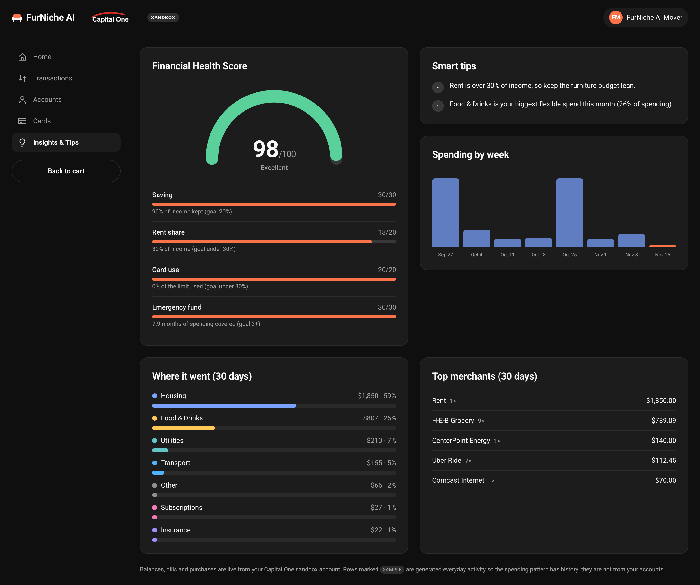

### Home Finance

For any listing, a finance page works out what the home costs a month and whether the mover can afford it from their Capital One accounts. It covers mortgage and pre-qualification, renting against buying, what moving in takes, and, for an owner, the home's value and equity. Rates are weekly averages and the approvals are simulated; none of it is an offer of credit.

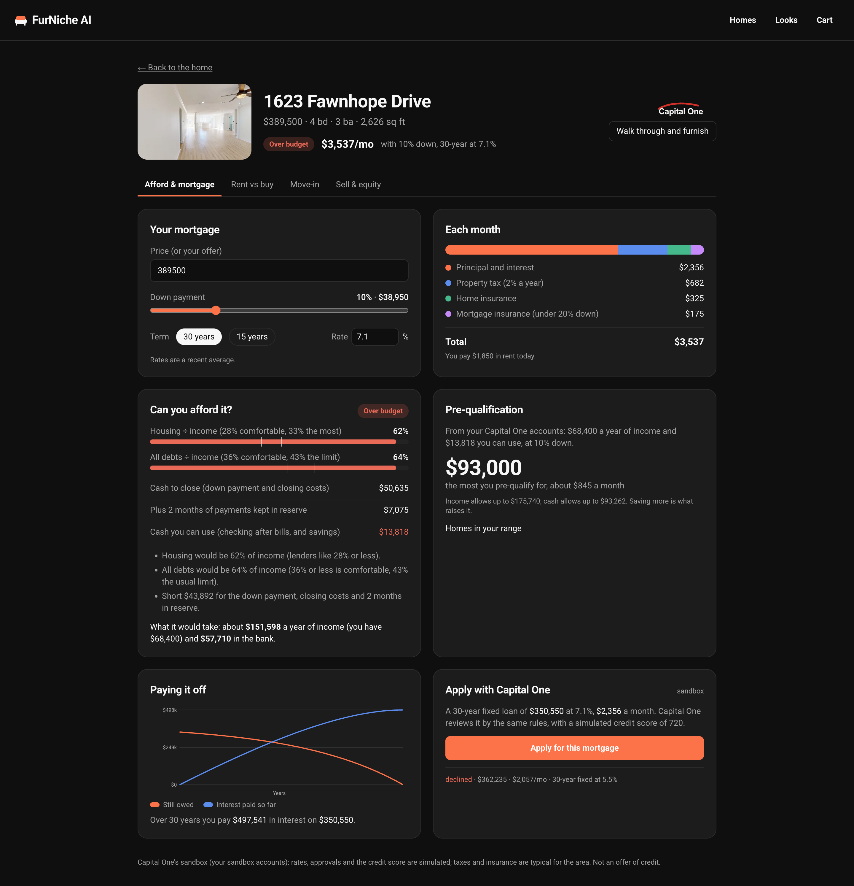
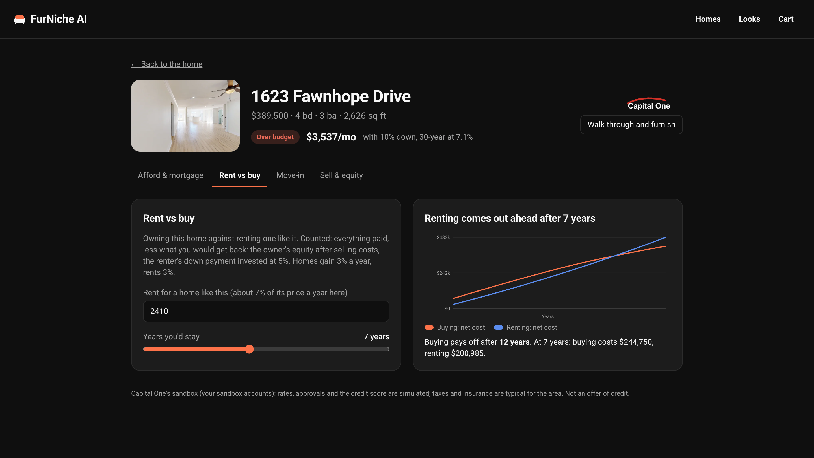
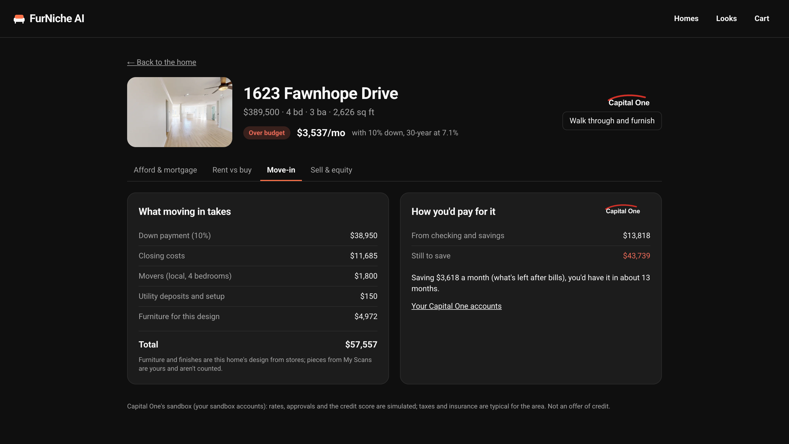
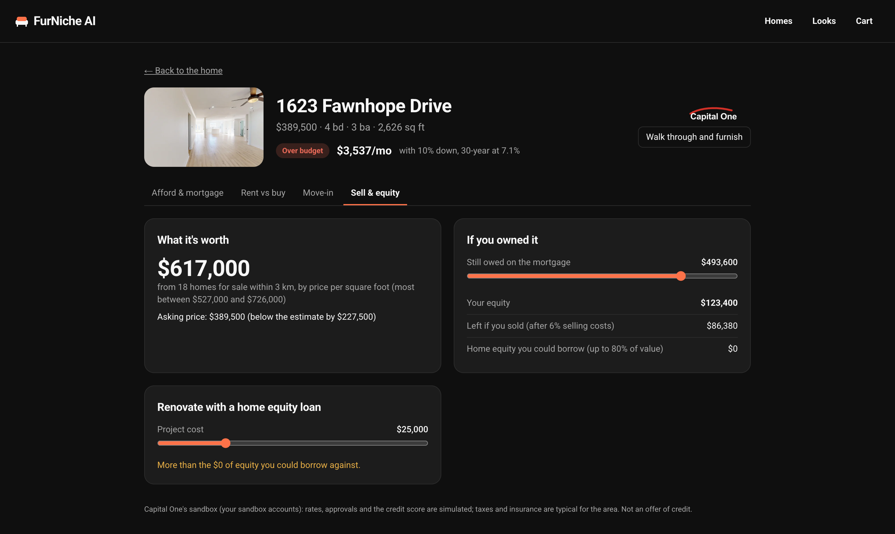

## Core User Flow (Find, Fly In, Furnish, Pay)

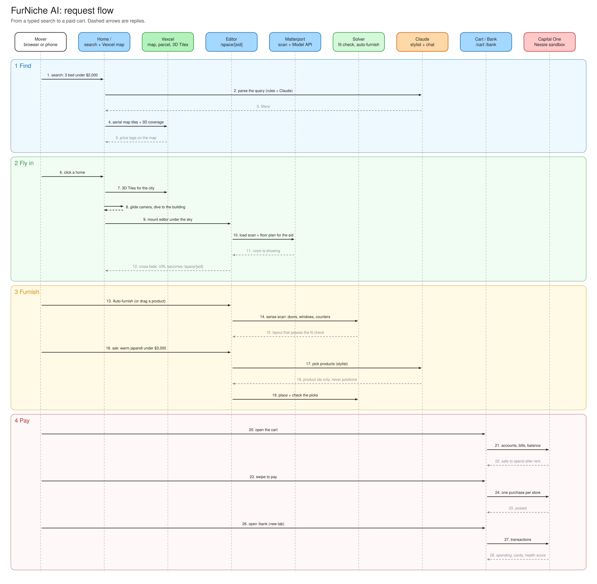

The editable source is [`assets/sequence-flow.excalidraw`](assets/sequence-flow.excalidraw).

### 1. Find

The mover types a search. The query becomes filters (rules, plus Claude when a key is set), and results land on the Vexcel aerial map and the home list.

### 2. Fly In

Choosing a home glides the camera over the 3D city and down to the building. While it descends, the Matterport scan loads underneath, and it cross-fades in as soon as the room is showing. The URL becomes `/space/[sid]`.

### 3. Furnish

Drag pieces in, ask the stylist, or press Auto-furnish for the whole home. The solver senses doors, windows and counters in the scan, places pieces against walls, and runs the fit check. Paint and flooring quantities update as you go.

### 4. Budget and Pay

The budget strip shows what the mover can safely spend after bills and a $500 cushion, with the card kept under 30% use. Swipe to pay, then open the dashboard to see the purchases posted.

### 5. Share

The share link carries the whole design in the URL. Designs are saved in the browser; there are no accounts and nothing is sold.

## Built With

Application

- Next.js 14 (App Router), React 18, TypeScript: web application framework
- Tailwind CSS and zustand: UI styling and state
- `@matterport/webcomponent` and `@matterport/r3f`: host the scan; furniture is drawn with three.js (react-three-fiber) inside Matterport's scene
- `3d-tiles-renderer`: the Vexcel 3D city; Leaflet for the search map

Data and APIs

- Matterport Model API (GraphQL) and Showcase SDK: rooms, walls, panoramas
- Vexcel property API, ortho tiles and 3D Tiles for Houston
- CoStar hackathon kit: listings and Matterport links
- Capital One Nessie v2 (sandbox): accounts, bills, purchases, transactions
- IKEA product pages: catalogue measurements, photos and live prices

AI

- Anthropic Claude: stylist, chat, product import and size estimates, each with a rule-based fallback
- Google Gemini API
- Photon: the same assistant over iMessage
- Hugging Face ZeroGPU Spaces, or your own GPU: Photo to 3D

Infrastructure and Deployment

- Vercel: Git deploys from `main`; a `prebuild` step fetches the git-ignored `data/` archive from a private Vercel Blob store and copies the Matterport viewer files
- A service worker caches the large Matterport model files in the browser

## Architecture Overview

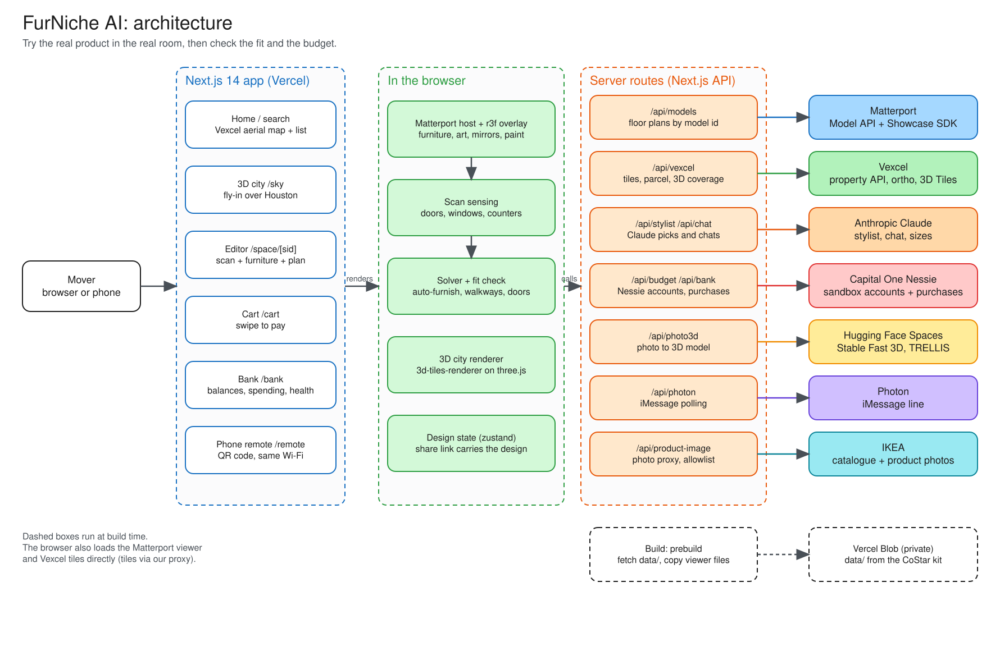

| Layer   | What it does                                                                                        | Where                                                       |
| ------- | --------------------------------------------------------------------------------------------------- | ----------------------------------------------------------- |
| Scan    | Hosts the Matterport tour in its defurnished view                                                   | `components/viewer/MatterportHost.tsx`                      |
| Overlay | Draws furniture, wall art, mirrors and paint with a depth occluder, so pieces sit behind real walls | `components/viewer/`                                        |
| Sensing | Raycasts the scan for doorways, windows, counters and plain wall                                    | `lib/scanSense.ts`                                          |
| Solver  | Places pieces against walls, keeps walkways clear, drops optional pieces that break the fit         | `lib/solver.ts`, `lib/autofurnish.ts`                       |
| Fit     | Separating-axis tests on footprints, walkway and door rules                                         | `lib/fit.ts`                                                |
| Stylist | Claude picks products, never positions                                                              | `app/api/stylist`, `lib/llm.ts`                             |
| Money   | Nessie accounts, bills, purchases, bank summary, home finance                                       | `lib/nessie.ts`, `lib/bankSummary.ts`, `lib/homeFinance.ts` |

## Development Setup

Needs Node.js 20.9 or newer.

```bash
git clone https://github.com/binaryshrey/Furniche.git
cd Furniche
npm install --legacy-peer-deps
cp .env.example .env.local          # fill in the keys
npx matterport-assets public/matterport-assets   # Matterport viewer files (not in git)
python3 scripts/build_listings.py   # builds data/listings.json (Houston; --region la for LA)
python3 scripts/build_ikea_catalog.py   # refreshes catalog/ikea-catalog.json from IKEA's search (optional)
# No matterport_kit/models_index.csv? Build one from the Model API, then point the script at it:
#   node scripts/build_model_index.mjs --kit <kit>
#   python3 scripts/build_listings.py --kit <kit> --index data/models_index.csv
npm run dev                          # http://localhost:3000
npm test
```

Open the app at `http://localhost:3000` (not `127.0.0.1`): the Matterport SDK key is limited to localhost. The CoStar kit and the generated `data/listings.json` are not in this repo; they come from the hackathon organisers.

### Configs

Create a `.env.local` file in the project root. The Matterport and Vexcel keys are required; the rest are optional and each has a fallback.

```
MATTERPORT_API_KEY=XXXXX-XXXXX
MATTERPORT_API_TOKEN=XXXXX-XXXXX
NEXT_PUBLIC_MATTERPORT_SDK_KEY=XXXXX-XXXXX
VEXCEL_API_KEY=XXXXX-XXXXX

# Optional
ANTHROPIC_API_KEY=XXXXX-XXXXX        # stylist, chat, product import (rule-based fallback)
NESSIE_API_KEY=XXXXX-XXXXX           # Capital One sandbox checkout and dashboard (demo data without it)
PHOTON_PROJECT_ID=XXXXX-XXXXX        # iMessage assistant
PHOTON_API_KEY=XXXXX-XXXXX
HF_TOKEN=XXXXX-XXXXX                 # more free GPU time for Photo to 3D
PHOTO3D_GPU_URL=XXXXX-XXXXX          # your own GPU for Photo to 3D, no daily limit
PHOTO3D_GPU_TOKEN=XXXXX-XXXXX
```

### Deploy

```bash
npm run lint && npm test            # lint errors fail the remote build
```

Pushes to `main` deploy to Vercel. The build runs `scripts/fetch-data.mjs`, which reads the git-ignored `data/` archive from a private Blob store, and copies the Matterport viewer files into `public/`. To update the data, run `bash scripts/pack-data.sh` and upload the archive as described in [`docs/DATA.md`](docs/DATA.md).

## Project Layout

| Path                                                          | What it holds                                                                                     |
| ------------------------------------------------------------- | ------------------------------------------------------------------------------------------------- |
| `app/`                                                        | Pages (`/`, `/space/[sid]`, `/sky`, `/cart`, `/bank`, `/finance/[sid]`, `/boards`) and API routes |
| `components/viewer/`                                          | Matterport host, furniture layer, surface (paint) layer, 3D furniture shapes                      |
| `components/bank/`, `components/finance/`, `components/shop/` | Capital One card, charts, finance pages, checkout, swipe to pay                                   |
| `lib/solver.ts`, `lib/autofurnish.ts`                         | Room layout solver and Auto-furnish                                                               |
| `lib/scanSense.ts`, `lib/closets.ts`, `lib/hang.ts`           | Scan sensing, closet and doorway inference, wall-art placement                                    |
| `lib/fit.ts`                                                  | Fit and walkway checks (pure, unit tested)                                                        |
| `lib/bankSummary.ts`, `lib/homeFinance.ts`, `lib/nessie.ts`   | Banking summary, home finance, Capital One sandbox                                                |
| `catalog/`                                                    | Curated product catalogue and the IKEA catalogue                                                  |
| `scripts/`                                                    | Listing, catalogue and model-index builders; data packing; Photo to 3D GPU helpers                |
| `assets/`                                                     | Screenshots and diagrams used in this README                                                      |

## How It Works

- `lib/matterport.ts` reads rooms, walls and panos from the Matterport Model API (GraphQL).
- `lib/vexcel.ts` reads the parcel and buildings from Vexcel's property API and frames the ortho image on the same centre so the overlay lines up. Ortho tiles and the 3D Tiles mesh go through server routes so the API key never reaches the browser.
- `/sky` renders the 3D city with `3d-tiles-renderer`. The Draco and KTX2 decoders in `public/decoders/` are copied from three.js. Vexcel's 3D collection covers Houston only.
- `lib/search.ts` turns plain-language queries into filters (rules, plus Claude when a key is set).
- `lib/fit.ts` and `lib/solver.ts` are pure functions with unit tests. `lib/scanSense.ts` raycasts the scan for doorways, windows and flat counters, and Auto-furnish uses them to keep pieces off doors and windows.
- Photo to 3D (`lib/photo3d.ts`, `/api/photo3d`) runs free on Hugging Face's shared GPUs, called with `@gradio/client`. Quick uses Stability AI's Stable Fast 3D and Max detail uses Microsoft's TRELLIS. Hugging Face meters free use per day, so build demo pieces ahead of time in the browser you will demo from; models are kept in the browser (IndexedDB) and cached on the server by the photo's hash. iPhone (HEIC) photos are converted on the server in WebAssembly. For no daily limit, run `scripts/photo3d_local.py` on this computer or `scripts/photo3d_gpu.ipynb` on a free Kaggle or Colab GPU, and set `PHOTO3D_GPU_URL`.
- The product catalogue is a curated sample; prices and sizes were checked on the date shown in the cart and may have changed.
